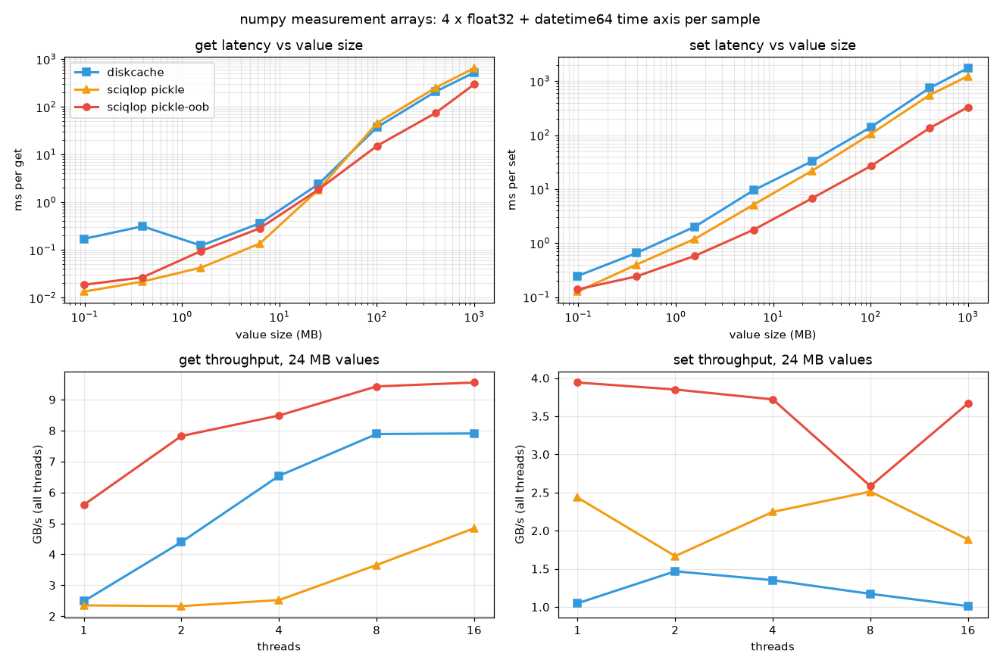

[](https://mit-license.org/)
[](https://pypi.org/project/pysciqlop-cache/)
[](https://pypi.org/project/pysciqlop-cache/)
[](https://codecov.io/gh/SciQLop/Sciqlop-cache/branch/main)
[](https://sciqlop-cache.readthedocs.io/en/latest/?badge=latest)

# SciQLop Cache

**A fast, persistent, process-safe key-value cache for Python, with a C++20 core.**

Store Python objects under keys on disk; any thread or process on the machine reads
them back, safely, even at the same time. It speaks diskcache's API, so most code
switches by changing the import.

```bash
pip install pysciqlop-cache
```

Wheels for Linux, macOS and Windows, x86-64 and ARM64, Python 3.10 to 3.15 (free-threaded
builds included). 📖 **[Documentation](https://sciqlop-cache.readthedocs.io/en/latest/)**

```python
from pysciqlop_cache import Cache

cache = Cache("/tmp/my-cache")
cache["sensor/temperature"] = {"ts": 1710000000, "values": [21.3, 21.5, 21.4]}

print(cache["sensor/temperature"])
# {'ts': 1710000000, 'values': [21.3, 21.5, 21.4]}
```

## What people use it for

**Cache slow functions and API calls.** Results survive restarts and are shared by every
process. `ignore` keeps sessions and clients out of the key; `async def` works too.

```python
@cache.memoize(expire=3600, ignore={"session"})
def fetch(url, session):
    return session.get(url).json()
```

**Share results between worker processes.** Workers of a `multiprocessing` pool share
one cache, whatever the start method (fork, forkserver, spawn); no server, no lock files.

```python
from multiprocessing import Pool

@cache.memoize()
def square(i):
    return i * i

if __name__ == "__main__":
    with Pool(4) as pool:
        print(sum(pool.map(square, range(100))))   # computed once, then read back
# 328350
```

**Keep big numpy arrays or data products on disk.** `PickleOOBSerializer` moves array
bytes in C++ without holding the GIL, compressing them when it pays off, so threads
loading data don't block each other.

```python
import numpy as np
from pysciqlop_cache import Cache, PickleOOBSerializer

arrays = Cache("/tmp/arrays", serializer=PickleOOBSerializer())
arrays["day/2026-01-01"] = np.random.random((1_000_000, 4))
```

**A dict bigger than memory.** `Index` is a persistent `MutableMapping` with no
expiration or eviction overhead.

```python
from pysciqlop_cache import Index

catalog = Index("/tmp/catalog")
catalog.update({"run-1": {"status": "done"}, "run-2": {"status": "failed"}})
print(catalog.get_many(["run-1", "run-3"]))   # one consistent snapshot
# {'run-1': {'status': 'done'}}
```

**Coordinate processes.** Atomic counters and a cross-process lock.

```python
cache.incr("downloads")
with cache.lock("refresh-token"):
    ...  # one process at a time
```

**Coming from diskcache?** One command copies a `Cache`, `FanoutCache` or `Index` over,
and the [compatibility page](https://sciqlop-cache.readthedocs.io/en/latest/diskcache.html)
lists the few differences.

```bash
python -m pysciqlop_cache.migrate /path/to/diskcache /path/to/sciqlop-cache
```

## Why use it?

- **Persistent and shareable**: threads and processes, including forked pools, share one
  cache directory; it can be copied to another machine, even another OS.
- **Bounded**: optional size limit with LRU eviction, per-key expiration, tags.
- **Fast**: small values live in SQLite, large ones in memory-mapped files (the split is
  [configurable](https://sciqlop-cache.readthedocs.io/en/latest/stores.html)). Compared
  with diskcache: writes 1.2 to 1.7x faster for small values and 2 to 4x from 64 KB,
  repeated reads of values above 8 KB up to 3x, batched small writes 3.7x, and write
  latency stays flat up to a million entries. diskcache writes 8 to 32 KB values about 2x
  faster; `max_blob_size` closes that gap ([benchmarks](https://sciqlop-cache.readthedocs.io/en/latest/performance.html)).
- **Crash-, fork- and race-tested**: interrupted writes and crashed processes leave no
  half-written values; `cache.check(fix=True)` repairs what an external hand broke.
- **Typed**: ships type information for mypy and pyright.

**Not for:** network filesystems (NFS, SMB), or processes on different machines sharing
one cache: SQLite's locking needs a local disk. Values are pickled by default, and
unpickling runs code: keep the folder private, or use the msgspec serializer
([security](https://sciqlop-cache.readthedocs.io/en/latest/serializers.html)).

## Learn more

| | |
|---|---|
| [Quickstart](https://sciqlop-cache.readthedocs.io/en/latest/quickstart.html) | dict API, expiration and tags, size limits, memoization, transactions |
| [Choosing a store](https://sciqlop-cache.readthedocs.io/en/latest/stores.html) | `Cache`, `Index`, `FanoutCache`, `FanoutIndex`, `max_blob_size` |
| [Threads, processes and transactions](https://sciqlop-cache.readthedocs.io/en/latest/concurrency.html) | what is safe, what runs in parallel, locks |
| [Serializers](https://sciqlop-cache.readthedocs.io/en/latest/serializers.html) | pickle, msgspec, and `PickleOOBSerializer` for big numpy arrays |
| [Coming from diskcache](https://sciqlop-cache.readthedocs.io/en/latest/diskcache.html) | one-command migration, API differences |
| [C++ guide](https://sciqlop-cache.readthedocs.io/en/latest/cpp.html) | the same engine from C++20 |
| [Performance](https://sciqlop-cache.readthedocs.io/en/latest/performance.html) | benchmarks against diskcache |
| [How it works](https://sciqlop-cache.readthedocs.io/en/latest/internals.html) | storage, crash and fork safety, self-healing |
| [API reference](https://sciqlop-cache.readthedocs.io/en/latest/api.html) | every class and method |

## Performance

Measured against diskcache, both with their default settings, on an NVMe disk.
Values from public datasets (CIFAR-10 images, NYC taxi trips as a DataFrame, Hurricane
ISABEL simulation fields, household power readings) and random noise, from 100 KB to
1 GB, on Linux:



More charts and the methodology are in the [performance page](https://sciqlop-cache.readthedocs.io/en/latest/performance.html).

## Building from source

```bash
pip install .                           # or, for development:
meson setup build -Dwith_tests=true
meson compile -C build
meson test -C build
```

See [installation](https://sciqlop-cache.readthedocs.io/en/latest/installation.html) for the build options.

## License

MIT
