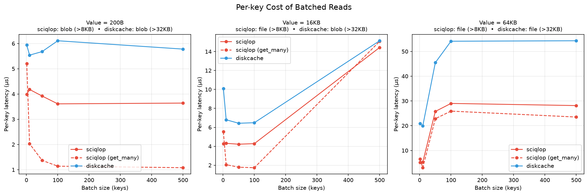
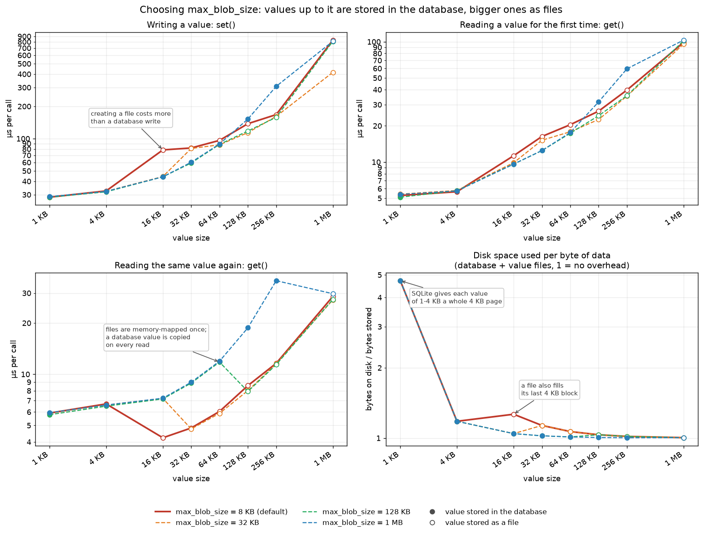
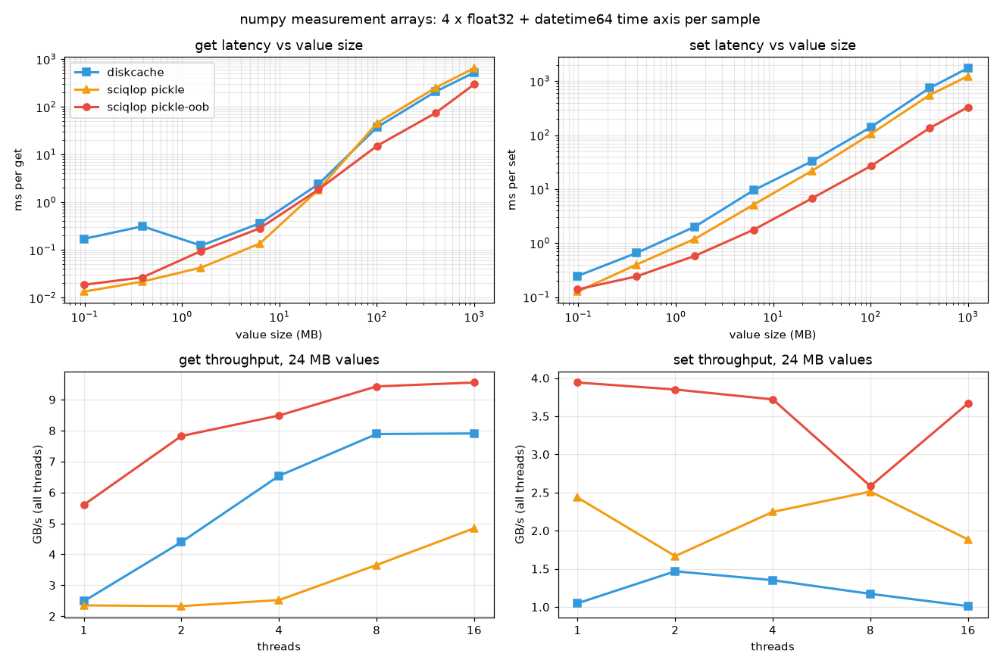
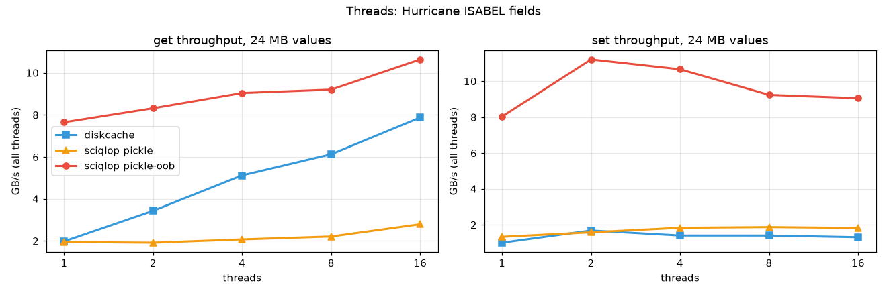
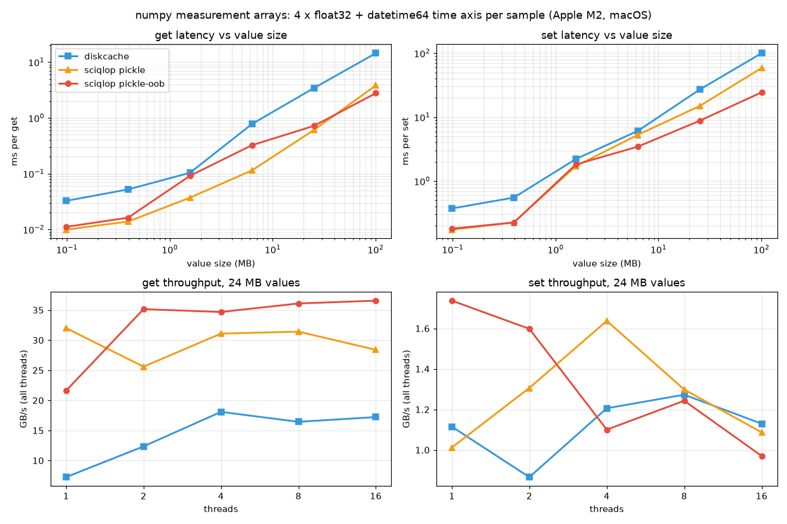

===========
Performance
===========

These benchmarks compare SciQLop Cache with `diskcache
<https://grantjenks.com/docs/diskcache/>`_. Each library runs **with its default
settings**, so the gaps come from the implementations.

**Held identical for both libraries:**

- The same machine, Python interpreter and benchmark process.
- The same storage: a RAM filesystem, so disk speed doesn't hide the library's own
  cost (``tmpfs`` on Linux, an APFS RAM disk on macOS; see below for the one exception).
- The same keys, values and number of operations, through the public Python API.
- SQLite in WAL mode with ``synchronous=NORMAL`` for both.

**Left at each library's default (the differences being measured):**

.. list-table::
    :header-rows: 1

    * -
      - SciQLop Cache
      - diskcache
    * - Engine
      - C++ core, nanobind bindings
      - pure Python on ``sqlite3``
    * - Values stored as files above
      - 8 KB
      - 32 KB
    * - Size limit, eviction
      - unlimited; LRU when a limit is set
      - 1 GiB, least-recently-stored

Every chart has a tab for each machine; switching one switches them all.

.. list-table::
    :header-rows: 1

    * -
      - Linux, x86-64
      - macOS, Apple M2
    * - CPU
      - AMD Ryzen 7 5800X (8 cores, 16 threads)
      - Apple M2 (4 performance + 4 efficiency cores)
    * - RAM
      - 63 GiB
      - 16 GiB
    * - OS
      - Fedora Linux 44
      - macOS 26.6
    * - Storage
      - ``tmpfs``
      - APFS RAM disk (``hdiutil``); internal SSD for the numpy arrays
    * - Python, diskcache
      - 3.14 (GIL build), 5.6.3
      - 3.14.7 (GIL build), 5.6.3

Scaling with the number of entries
==================================

100 to 1 M entries of 256 bytes. Latency stays flat as the cache grows:

.. tab-set::
    :sync-group: platform

    .. tab-item:: Linux, x86-64
        :sync: linux

        .. image:: ../benchmark/scaling_chart.png
            :alt: set and get latency from 100 to 1M entries (Linux, AMD Ryzen 7 5800X)

    .. tab-item:: macOS, Apple M2
        :sync: macos

        .. image:: ../benchmark/macos-m2/scaling_chart.png
            :alt: set and get latency from 100 to 1M entries (macOS, Apple M2)

.. tab-set::
    :sync-group: platform

    .. tab-item:: Linux, x86-64
        :sync: linux

        .. image:: ../benchmark/scaling_violin.png
            :alt: latency distribution (Linux, AMD Ryzen 7 5800X)

    .. tab-item:: macOS, Apple M2
        :sync: macos

        .. image:: ../benchmark/macos-m2/scaling_violin.png
            :alt: latency distribution (macOS, Apple M2)

Latency vs value size
=====================

Raw ``bytes`` values from 64 B to 1 MB. The dashed line is SciQLop Cache with a 1 GiB
size limit, diskcache's default:

.. tab-set::
    :sync-group: platform

    .. tab-item:: Linux, x86-64
        :sync: linux

        .. image:: ../benchmark/valuesize_chart.png
            :alt: set and get latency vs value size (Linux, AMD Ryzen 7 5800X)

    .. tab-item:: macOS, Apple M2
        :sync: macos

        .. image:: ../benchmark/macos-m2/valuesize_chart.png
            :alt: set and get latency vs value size (macOS, Apple M2)

**A size limit costs nothing.** The dashed line follows the solid one. A read doesn't
write the entry's last use to the database: it notes it in memory, and the background
thread writes them all once per second (see :doc:`internals`).

Values from 8 KB to 32 KB are the one range where diskcache is faster. SciQLop Cache stores
them as files, while diskcache keeps them in SQLite up to 32 KB.

- **Writes:** 130 µs against 37 µs on the M2, 69–71 µs against 39–40 µs on the Ryzen. A file
  costs ~100 µs more than a blob on the M2 (~40 µs on the Ryzen): on APFS, ``open`` with
  ``O_CREAT`` alone takes 32 µs and ``close`` 10 µs.
- **First read of a value:** 11 µs against 6–7 µs on the Ryzen, the cost of opening the
  file. From 64 KB, where diskcache uses files too, both are level.
- **Reading the same value again** is faster than diskcache from 8 KB up, 1.4x at 16 KB
  and 3x at 64 KB on the Ryzen: SciQLop Cache keeps the last 128 values it loaded from
  files in memory, so it doesn't open the file again.

The M2 chart predates the "first read" measurement and the size-limited line, so it has
neither.

Batched transactions
====================

Writing many values in one ``transact()`` block spreads the commit cost over the batch.
The per-operation cost drops sharply, especially for small values. ``set_many`` (dashed)
does the same in one call and serializes every value before taking the lock:

.. tab-set::
    :sync-group: platform

    .. tab-item:: Linux, x86-64
        :sync: linux

        .. image:: ../benchmark/batch_per_op_chart.png
            :alt: per-operation latency vs batch size (Linux, AMD Ryzen 7 5800X)

    .. tab-item:: macOS, Apple M2
        :sync: macos

        .. image:: ../benchmark/macos-m2/batch_per_op_chart.png
            :alt: per-operation latency vs batch size (macOS, Apple M2)

Reading many keys: ``get_many`` (dashed) reads them all in one call, from one snapshot,
against a loop of ``get()`` that keeps the values in a dict, as ``get_many`` does:

Up to a hundred keys, ``get_many`` costs a third to half of the loop. With hundreds of
values stored as files, both spend most of their time allocating the values they return,
and that cost changes between runs with the process's memory history (the 64 KB panel
ranged from 5 to 25 µs per key, for both). The Apple M2 charts predate ``set_many`` and
``get_many``.

Choosing ``max_blob_size``
==========================

Values up to ``max_blob_size`` are stored in the database, bigger ones as files (see
:doc:`stores`). This sweep runs four thresholds over value sizes from 1 KB to 1 MB, on
the Linux machine above (``tmpfs``). The fastest of three runs is kept per point.

Filled markers are values stored in the database, hollow ones values stored as files.

- **Writes**: a database blob beats a file creation for 16 and 32 KB values (16 KB:
  44 µs vs 78 µs). At 64 KB it is even, and from 128 KB on a blob is slower (256 KB:
  307 µs vs 167 µs). On a real disk, where creating a file costs more, blobs win up to
  64 KB.
- **Repeated reads** favour files from 16 KB on: a file is memory-mapped once, a blob is
  copied out of SQLite on every read (64 KB: 6 µs vs 12 µs).
- **First reads** are about even up to 64 KB; from 128 KB blobs are slower.
- **Disk space**: a value of 1 to 4 KB takes a whole 4 KB page of the database, so a
  1 KB value uses 4.7 times its size on disk, whatever the threshold. A file wastes the
  unused end of its last 4 KB block: a 16 KB value uses 1.26 times its size as a file,
  1.05 times in the database. From 64 KB on, both are within 7 % of the data.

So raising ``max_blob_size`` to 32 KB (64 KB on a real disk) makes writing such values
cheaper and removes their files, at the price of slower repeated reads. The database
grows by what the files held; the total disk space doesn't. Above about 128 KB, files win on every count. One point is unexplained: 1 MB
values wrote twice as fast in the 32 KB run, though they are files in every run.

Large values: public datasets
=============================

Here each value comes from a public dataset, sliced or tiled to sizes from 100 KB to
1 GB, so compression meets real data:

- **images**: CIFAR-10 [#cifar]_, a uint8 array of 32x32 colour images, the batch an ML
  pipeline caches;
- **table**: NYC taxi trips [#taxi]_, January to March 2024, a pandas DataFrame with
  timestamps, floats, integers and strings;
- **fields**: Hurricane ISABEL from SDRBench [#sdrbench]_, float32 simulation fields
  (100x500x500 each, 13 of them);
- **sensor**: household power readings [#uci]_, a datetime64 axis with 7 float64
  channels, one sample a minute;
- **noise**: random float32 with a datetime64 axis, the incompressible worst case.

A value bigger than its dataset is the dataset repeated (images above 184 MB, sensor
above 133 MB): repeated data can compress better than unique data of that size. All
three store values with pickle protocol 5. diskcache and the default serializer keep
the array bytes inside the pickle; :class:`~pysciqlop_cache.PickleOOBSerializer` stores
them next to it, compressed when that pays off (see :doc:`serializers`). Median of
three runs (five for threads); the datasets are downloaded on first use (~1.6 GB).

These stores live on the NVMe disk (btrfs), not a RAM filesystem: without ``fsync`` a
write only reaches the page cache, and on this machine ``tmpfs`` is the slower of the
two (a plain 25 MB file write: 9.5 ms on ``tmpfs``, 3.1 ms on btrfs), because it takes
memory 4 KB at a time. The disk column is what the library writes (file sizes);
btrfs's own compression comes after.

- **Writes:** pickle-oob is the fastest from a few MB up on images, tables, fields and
  noise, up to 10x: 1 GB of images in 0.13 s, against 1.3 s for the default serializer
  and 1.4 s for diskcache. The arrays go to disk with no copy into a pickle buffer. The
  sensor data is the exception: pickle-oob writes it slower than the default serializer
  (1 GB: 2.0 s vs 1.3 s), see the next point.
- **Disk:** what compresses is what has structure: simulation fields (6x up to 100 MB),
  time axes (noise: 29 % saved, all of it from the time axis), tables (23 %). Images and
  the sensor's float64 channels barely compress. pickle-oob decides per array, from its
  first 64 KB: an array whose start compresses is compressed whole, and kept only if the
  whole array shrinks 2x. A 1 GB value of ten Hurricane fields starts with a mostly empty
  one, so it is compressed, then stored raw because the other fields compress less; the
  sensor's float64 channels start compressible too, and the wasted attempt costs about
  a second per GB.
- **Reads, one thread:** below a few MB the default serializer is the fastest: the
  benchmark reads the same key again, and SciQLop Cache keeps the last loaded files open,
  so only unpickling is left. From 100 MB, pickle-oob is the fastest on every dataset but
  the sensor one, 2.2x to 4.9x the default serializer (1 GB of images: 0.14 s, vs 0.59 s,
  and 0.49 s for diskcache). From 100 MB the default serializer reads slower than
  diskcache: its copy into the pickle runs with the GIL held.
- **Very large reads and huge pages:** a decoded array is fresh memory, and numpy asks
  the kernel for 2 MB pages for it. When free memory is fragmented, the kernel tries to
  compact it on every page fault, fails, and falls back to 4 KB pages: with 24 GB of
  stale files in a RAM ``/tmp``, a 1 GB pickle-oob read took 1 s instead of 0.24 s
  (``/proc/vmstat``: ``compact_fail``). Any large numpy allocation pays this, not only
  the cache; ``NUMPY_MADVISE_HUGEPAGE=0`` trades the fast case for a steady 0.5 s.

Threads, on 24 MB of Hurricane fields, 1 to 16 threads each reading or writing its own
keys:

- **Reads:** pickle-oob copies array bytes without the GIL: 7.2 GB/s on one thread,
  10 GB/s on 16, against 2.1 to 8.3 GB/s for diskcache (its file reads release the GIL)
  and 2.2 to 3.3 GB/s for the default serializer (it copies with the GIL held).
- **Writes:** SQLite takes one writer at a time, so no library scales. pickle-oob
  sustains about 10 GB/s, because these fields compress 6x; the others stay below
  2 GB/s.

On the Apple M2, an older version of this benchmark (random noise only, up to 100 MB)
gives the same picture, with faster reads for every library: the M2's memory moves a
100 MB value in 2.8 ms with pickle-oob (14.5 ms for diskcache). Its writes went to the
internal SSD, at 0.9 to 1.7 GB/s for all three, so they can't be compared with
``tmpfs``.

The Linux runs were not on an idle machine: the btrfs writeback of earlier values runs
while later ones are measured, as it would in real use, and pushed the load average to
5 to 10. Points where the runs disagreed were checked: two of three agree everywhere,
except for four thread points, which got five runs.

.. [#cifar] A. Krizhevsky, *Learning Multiple Layers of Features from Tiny Images*,
   2009, https://www.cs.toronto.edu/~kriz/cifar.html
.. [#taxi] NYC Taxi & Limousine Commission trip record data,
   https://www.nyc.gov/site/tlc/about/tlc-trip-record-data.page
.. [#sdrbench] SDRBench, https://sdrbench.github.io; K. Zhao et al., IEEE Big Data 2020.
   Hurricane ISABEL data from the IEEE Visualization 2004 contest (NCAR).
.. [#uci] G. Hebrail and A. Berard, *Individual household electric power consumption*,
   UCI Machine Learning Repository, 2006, https://doi.org/10.24432/C58K54 (CC BY 4.0)

Reproducing the benchmarks
==========================

Use a release build and a RAM filesystem. ``TMPDIR`` decides where both libraries put
their cache directories. ``-Db_ndebug=if-release`` builds like the wheels do: without it,
macOS's libc++ checks the bounds of every ``std::span`` access.

.. code-block:: console

    $ meson setup build --buildtype=release -Db_ndebug=if-release && meson compile -C build
    $ export TMPDIR=/dev/shm PYTHONPATH=build

On macOS, make a 2 GB RAM disk first, and run ``bench_arrays.py`` with ``TMPDIR`` on the
internal SSD (it needs more space than that). Write the results and charts to
``benchmark/macos-m2/``, and pass ``--machine "Apple M2, macOS"`` to the ``plot_*.py``
scripts:

.. code-block:: console

    $ diskutil erasevolume APFS sqcbench $(hdiutil attach -nomount ram://4194304)
    $ export TMPDIR=/Volumes/sqcbench PYTHONPATH=build

    $ python benchmark/env.py            # prints the environment table

    $ python benchmark/scaling.py --max-entries 1000000 --backend both > benchmark/scaling_results.csv
    $ python benchmark/plot_scaling.py benchmark/scaling_results.csv -o benchmark/scaling_chart.png
    $ python benchmark/scaling.py --max-entries 1000000 --raw --backend both > benchmark/scaling_raw.csv
    $ python benchmark/plot_scaling.py benchmark/scaling_raw.csv --violin -o benchmark/scaling_violin.png

    $ python benchmark/bench_valuesize.py > benchmark/valuesize_results.csv
    $ python benchmark/plot_valuesize.py benchmark/valuesize_results.csv -o benchmark

    $ python benchmark/bench_blob_size.py > benchmark/blob_size_results.csv
    $ python benchmark/plot_blob_size.py benchmark/blob_size_results.csv -o benchmark/blob_size_chart.png

    $ python benchmark/bench_arrays.py > benchmark/arrays_results.csv   # downloads ~1.6 GB once
    $ python benchmark/plot_arrays.py benchmark/arrays_results.csv -o benchmark/arrays_chart.png
